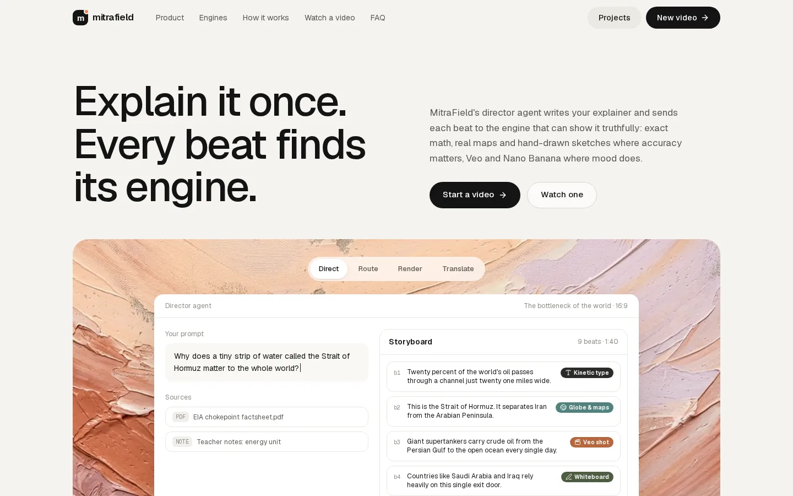
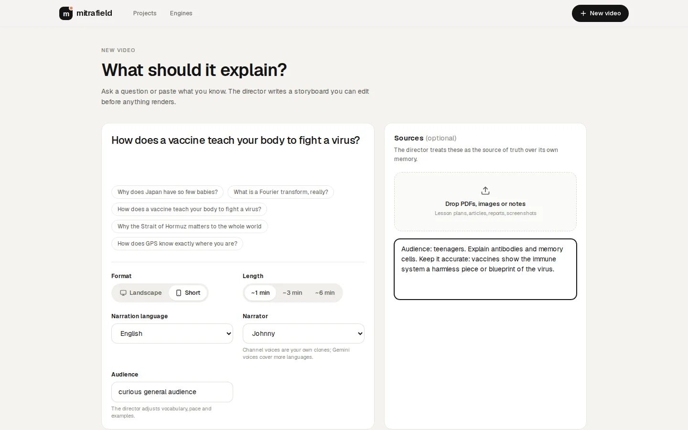
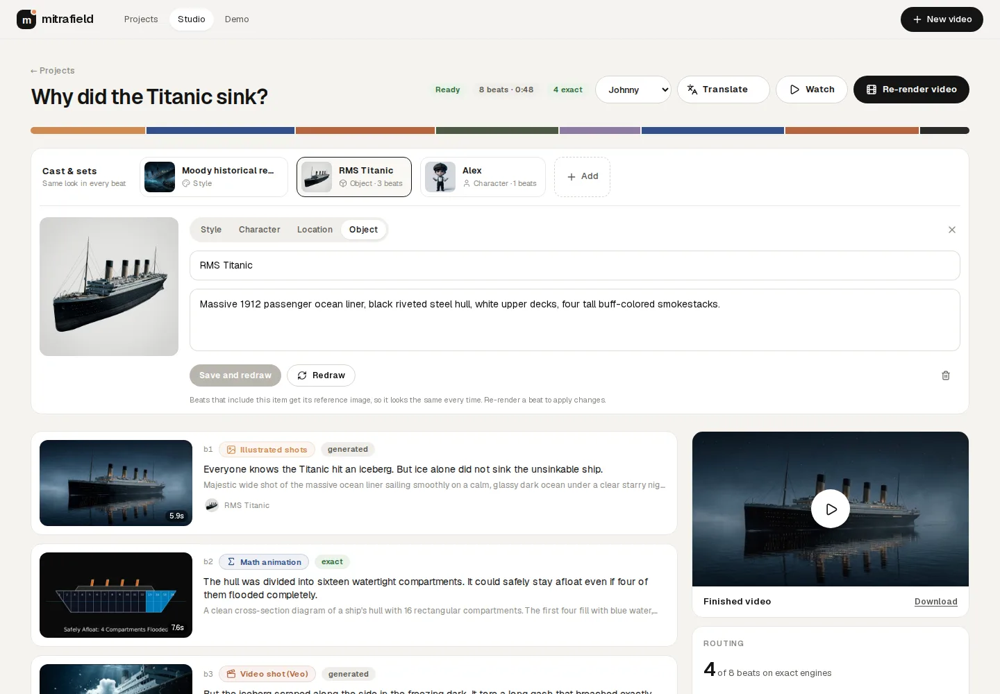
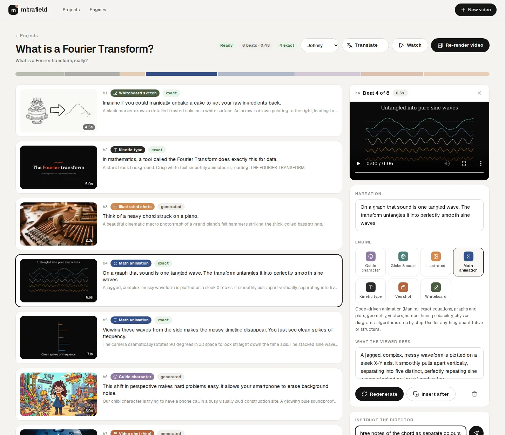
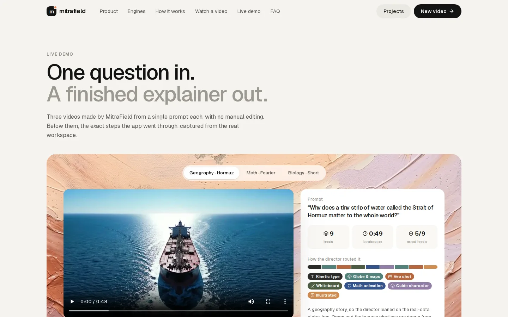

# MitraField: explainer videos, directed by AI

> Explain it once. Every beat finds its engine.

MitraField turns a question (plus your notes or PDFs) into a finished, narrated explainer video. A Gemini
**director agent** writes the story beat by beat and sends every beat to the engine that can show it
truthfully: **exact, code-drawn engines** for math, maps, charts, timelines and processes, and
**generative engines** (Nano Banana, Veo) for mood, people and places. Facts are computed, never
hallucinated by a pixel model.

Built for the **Google Cloud AI Builder Cup 2026** · Theme: **Media, Content & Digital Experiences** · by Viraj Sawad.



| Ask a question | Studio with Cast & Sets |
|---|---|
|  |  |
| **Edit one beat in plain words** | **Live demo with real results** |
|  |  |

- **Demo video (2:08):** [`docs/demo-video/MitraField_Demo.mp4`](docs/demo-video/MitraField_Demo.mp4)
- **Deck (PDF):** [`docs/deck/MitraField_Deck.pdf`](docs/deck/MitraField_Deck.pdf)

## The flow

| # | Step | Who | What actually happens |
|---|------|-----|-----------------------|
| 1 | Ask | You | A question, format (landscape or vertical Short), length, language, narrator, audience, optional sources |
| 2 | Storyboard + cast | **Director agent** (Gemini 3.1 Pro) | Narration written for the ear, one engine per beat, and the recurring cast: style, characters, objects, places |
| 3 | Narrate | Gemini TTS | Each line is voiced first, so its visual renders to the exact length; every line is transcribed and retaken if it drifts |
| 4 | Render + self-check | Engines | Beats render in parallel. Manim code is repaired from tracebacks and inspected by Gemini vision for overlapping text |
| 5 | Edit one beat | You + director | Change a line, swap an engine, toggle cast, or say "show it on a map". Only that beat re-renders |
| 6 | Assemble + translate | Lyria, ffmpeg | Topic-matched music ducked under the voice, -14 LUFS, subtitles; one-click language versions reuse the visuals |

## Eleven engines

| Engine | Kind | Shows |
|---|---|---|
| Motion scene | exact | Gemini writes an animated HTML/SVG scene in the project's look, rendered frame-exact in headless Chrome |
| Math animation | exact | Gemini writes Manim code for the beat's exact duration, renders, repairs, checks frames |
| Globe & maps | exact | Natural Earth borders on an orthographic globe: flights, highlights, pins, great-circle routes |
| Data chart | exact | Bars that count up or a self-drawing trend line, from numbers in your sources |
| Timeline | exact | Events landing at their real dates |
| Flow diagram | exact | Steps and arrows as a sequence, a cycle or a tree |
| Whiteboard | exact | Nano Banana line art drawn on stroke by stroke |
| Kinetic type | exact | Hooks, definitions, key numbers |
| Cinematic shots | generated | Nano Banana stills in the project's look with smooth camera moves |
| Presenter | generated | One recurring character, same design in every beat |
| Veo shots | generated | Hero motion (max two per video), animated from on-model first frames |

Adding a style is one file in `backend/engines/` implementing `render(scene, project, duration, out_dir)`;
the director discovers it from its description.

## Ten looks

Every project picks an art direction: **Cinematic**, **Editorial flat**, **Premium 3D**, **Ink & wash**,
**Motion graphics**, **Archival**, **Woodblock**, **Paper collage**, **Isometric** or **Blueprint**. A look sets
the style of every generated image and its character rules (adult, on-model, never mascot-like), and gives
the code-drawn engines its palette and paper texture, so the whole video matches. One shared guard keeps out
the cheap AI-art feel.

## Cast & Sets

Like Google Flow's ingredients: the director defines the recurring style, characters, objects and places
with the storyboard. Each gets one reference image, and every generated beat (stills, the guide
character, Veo first frames) is drawn from the references it contains. In the Titanic demo the same ship
appears in the opening still and both Veo shots. Cast items are editable in the studio.

## Google stack

| Job | Google technology |
|---|---|
| Director, routing, cast, rewrites, translation | Gemini 3.1 Pro |
| Engine planning, Manim code, vision QA, narration transcripts | Gemini Flash |
| Stills, characters, line art, cast references | Nano Banana (Gemini image) |
| Hero video, image-to-video | Veo 3.1 (Fast; Lite in draft mode) |
| Narration | Gemini TTS |
| Music bed | Lyria |
| Models, in production | Gemini API, key in Secret Manager (worker only); `STUDIO_VERTEX=1` for Vertex AI with the service identity |
| Hosting | Cloud Run (public API service + private worker service), Cloud Tasks (durable render jobs), Firestore (project state), Cloud Storage (media), Firebase Hosting (static UI on a CDN), Secret Manager, Cloud Build, Artifact Registry |

Every billable call is priced from Google's published rates and logged per project; the studio shows the
running cost. A 50 s Short with two Veo shots costs about $2.

## Run locally

```bash
git clone https://github.com/VirajSawad1021/MitraField.git && cd MitraField
python3 -m venv .venv && .venv/bin/pip install -r requirements-dev.txt
echo "GEMINI_API_KEY=..." > .env
.venv/bin/uvicorn backend.app:app --host 0.0.0.0 --port 8020     # API + built UI at http://localhost:8020
cd web && npm ci && npm run dev                                   # UI hot-reload at :3000 (proxies /api to 8020)
cd web && NODE_ENV=production npx next build                      # rebuild the static UI served by 8020
```

Locally everything runs in one process (`STUDIO_ROLE=all`, JSON files, in-process job threads). Manim runs with the
interpreter that has it installed; set `STUDIO_MANIM_PY` if yours lives elsewhere. Narration can also use the
channel's own OmniVoice clones (Johnny, Viraj v8) and any voice created on the Voices page, rendered by the `voice/` GPU service (`STUDIO_OMNI_URL`; locally `docker run --gpus all -p 8012:8080` the `voice/` image). Without it, narration uses Gemini voices.

```bash
.venv/bin/ruff check .                                            # lint
.venv/bin/pytest -q                                               # tests (file store, local queue)
firebase emulators:exec --only firestore --project demo-mitrafield ".venv/bin/pytest -q"   # + the Firestore store tests
```

## Deploy

How it is built, why, and where its limits are: [docs/ARCHITECTURE.md](docs/ARCHITECTURE.md).

```bash
# once: APIs, Firestore, bucket, queue, service accounts, secret, budget alert, GitHub trust (idempotent)
PROJECT=my-gcp-project GITHUB_REPO=owner/repo BILLING_ACCOUNT=XXXXXX-XXXXXX-XXXXXX STUDIO_PASSCODE=choose-one ./deploy/bootstrap.sh
# first deploy from a laptop (every later one is a push to main)
PROJECT=my-gcp-project ./deploy/deploy.sh
# copy finished local projects into the deployed app
GOOGLE_CLOUD_PROJECT=my-gcp-project .venv/bin/python -m backend.seed 0846ab6934 a834483018
```

Every push to `main` runs CI (lint, tests incl. the Firestore emulator, web build, image build) and then deploys:
the worker and the API each go out as a no-traffic canary, must pass a gate (a real model call and a Firestore round
trip for the worker; readiness for the API), and only then receive traffic. Firebase Hosting is released last.
Authentication is Workload Identity Federation, so no key is stored in GitHub.

## Layout

```
backend/
  app.py          FastAPI: projects, sources, scenes, cast, render, translate, passcode guard; STUDIO_ROLE api | worker | all
  worker.py       private job endpoint (OIDC-verified) and the deploy gate's selftest
  jobs.py         enqueue(): Cloud Tasks in production, threads locally
  tasks.py        every background job, registered by name and idempotent
  store.py        project state: Firestore (transactions) or files; spend counters
  sandbox.py      static check, clean env and no-network for model-written Manim code
  log.py          structured JSON logging for Cloud Logging
  director.py     storyboard + cast / rewrite one beat / translate (Gemini)
  cast.py         Cast & Sets: reference images and per-beat references
  pipeline.py     per-beat narrate -> plan -> render -> fit, assembly; content-hash cache
  costs.py        per-project cost ledger
  gemini.py       one client for text, JSON, Nano Banana, TTS, Veo, Lyria (Vertex AI with STUDIO_VERTEX=1)
  engines/        title, globe, manim, chart, timeline, flow, whiteboard, image, character, veo
web/              Next.js app: landing, demo, new video, projects, studio
deploy/           bootstrap.sh (infrastructure), deploy.sh (gated canary deploy), cloudbuild.yaml
.github/          CI and CD workflows
tests/            unit, API, orchestration and Firestore-emulator tests
docs/             spec, deck, demo video, screenshots
```
